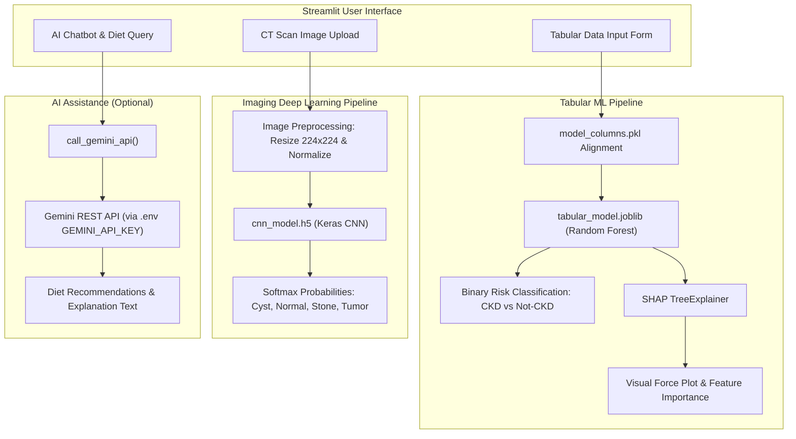

# AI-Powered Chronic Kidney Disease (CKD) Prediction Dashboard

> An interactive clinical decision-support prototype combining Machine Learning on clinical indicators, Convolutional Neural Networks on renal CT scans, and SHAP explainability.

---

## 1. Project Overview

Chronic Kidney Disease (CKD) is a progressive condition characterized by gradual loss of renal function. Early detection is critical to slow disease progression and prevent end-stage renal failure.

The **AI-Powered Chronic Kidney Disease Prediction Dashboard** is an exploratory clinical informatics prototype designed to:
1. Screen patient risk using 24 standard clinical/tabular indicators via an ensemble Random Forest model.
2. Classify renal computed tomography (CT) images into four categories: **Cyst**, **Normal**, **Stone**, and **Tumor** via a trained Convolutional Neural Network (CNN).
3. Provide transparent feature-level explanations for predictions using **SHAP (SHapley Additive exPlanations)**.
4. Provide nutritional and educational guidance via an optional Gemini-powered assistant.

---

## 2. Problem Statement & Intended Users

- **Problem:** Clinicians and researchers often face siloed data streams—clinical pathology reports are evaluated separately from radiological CT scans. Furthermore, many ML models function as black boxes, making it difficult for healthcare practitioners to trust their outputs.
- **Intended Users:** Healthcare informatics students, clinical researchers, and technical evaluators exploring multi-modal diagnostic workflows.

---

## 3. Key Features

### Implemented Features
- **Tabular Risk Prediction:** Evaluates 24 clinical features (blood pressure, specific gravity, albumin, serum creatinine, blood urea, hemoglobin, etc.) using a Scikit-learn Random Forest classifier.
- **SHAP Explainability Engine:** Generates TreeExplainer SHAP force plots and summary bar charts showing exactly how each clinical marker influenced the prediction score.
- **Renal CT Scan Classification:** Evaluates uploaded CT scans across 4 distinct classes (`Cyst`, `Normal`, `Stone`, `Tumor`) using a deep CNN architecture.
- **Interactive Multi-Page UI:** Built with Streamlit, offering streamlined navigation across Home, Tabular Prediction, CT Scan Analysis, AI Diet Planner, and Explanatory Chatbot views.
- **Secure Environment Management:** API keys are retrieved from environment variables (`.env`) or Streamlit secrets, preventing credential leakage.

### Planned Features (Roadmap)
- **Real-Time Grad-CAM Visualizations:** Heatmap overlays highlighting regions of interest on the CT scans.
- **FHIR / HL7 Data Ingestion:** Standardized electronic health record (EHR) schema connectors.
- **Multi-modal Late Fusion:** Combining tabular risk probability and imaging softmax logits into a unified calibrated risk score.

---

## 4. Verified Technology Stack

- **Core Language:** Python 3.10+
- **Machine Learning & Tabular Models:** Scikit-learn, Joblib, Pandas, NumPy
- **Deep Learning & Image Processing:** TensorFlow, Keras, Pillow (PIL)
- **Model Explainability:** SHAP (SHapley Additive exPlanations)
- **Frontend & Dashboard:** Streamlit, Streamlit Components
- **AI Services:** Google Gemini API (`gemini-2.5-flash-preview` / `gemini-1.5-flash`) via `requests`
- **Testing:** Pytest

---

## 5. Architecture Overview



---

## 6. Repository Folder Structure

```
chronic-kidney-disease-prediction/
│
├── streamlit_app.py           # Main interactive Streamlit application
├── tabular_model.joblib       # Pre-trained Random Forest model (24 features)
├── model_columns.pkl          # Serialized feature column specifications
├── download_weights.py        # Verification and setup script for weights
├── requirements.txt           # Verified Python dependencies
├── .env.example               # Template for environment configuration
├── .gitignore                 # Excludes .env, large model binaries (*.h5), caches
│
└── tests/
    └── test_ckd_models.py     # Unit tests verifying model loading and inference
```

---

## 7. Installation and Configuration

### Prerequisites
- Python 3.10, 3.11, or 3.12
- Git

### 1. Clone the Repository
```bash
git clone https://github.com/Suharshith/chronic-kidney-disease-prediction.git
cd chronic-kidney-disease-prediction
```

### 2. Create and Activate a Virtual Environment
```bash
# Windows (PowerShell)
python -m venv .venv
.venv\Scripts\Activate.ps1

# Linux / macOS
python3 -m venv .venv
source .venv/bin/activate
```

### 3. Install Dependencies
```bash
pip install -r requirements.txt
```

### 4. Configure Environment Variables (Optional for AI Chat)
Copy `.env.example` to `.env` and insert your Gemini API key:
```bash
cp .env.example .env
```
In `.env`:
```ini
GEMINI_API_KEY=your_actual_gemini_api_key_here
```
*(Note: If no API key is provided, the ML Tabular Prediction and CT Scan Classification continue to function normally without AI text generation).*

### 5. Verify Model Artifacts
Run the verification script to check your local model files:
```bash
python download_weights.py
```
> **Note on `cnn_model.h5`:** The tabular model (`tabular_model.joblib`) is included directly in this repository. Due to GitHub's 100 MB file size limit, the 228.5 MB `cnn_model.h5` binary is excluded via `.gitignore`. If running CT scan classification, copy `cnn_model.h5` into the project root directory.

---

## 8. Execution Commands

Launch the Streamlit web dashboard:
```bash
streamlit run streamlit_app.py
```
Open your browser and navigate to `http://localhost:8501`.

---

## 9. Model Verification & Supported Inputs

The tabular model expects 24 clinical parameters:

| Category | Parameters |
|---|---|
| **Vital & Urine Chemistry** | Blood Pressure (`bp`), Specific Gravity (`sg`), Albumin (`al`), Sugar (`su`), Pus Cells (`pc`), Pus Cell Clumps (`pcc`), Bacteria (`ba`), Red Blood Cells (`rbc`) |
| **Blood Chemistry** | Blood Glucose Random (`bgr`), Blood Urea (`bu`), Serum Creatinine (`sc`), Sodium (`sod`), Potassium (`pot`), Hemoglobin (`hemo`), Packed Cell Volume (`pcv`), White Blood Cell Count (`wc`), Red Blood Cell Count (`rc`) |
| **History & Symptoms** | Hypertension (`htn`), Diabetes Mellitus (`dm`), Coronary Artery Disease (`cad`), Appetite (`appet`), Pedal Edema (`pe`), Anemia (`ane`), Age (`age`) |

---

## 10. Automated Testing

Run the automated test suite with `pytest`:
```bash
pytest tests/test_ckd_models.py -v
```

Verified test coverage includes:
- Model artifact presence and file validity.
- Exact 24-feature schema alignment and column name matching.
- Inference pipeline execution on synthetic patient vectors.
- Probability distribution verification ($P(\text{class}) \in [0, 1], \sum P = 1.0$).

---

## 11. Known Limitations

1. **Experimental Prototype:** The models were trained on retrospective academic benchmark datasets (UCI Kidney Disease dataset and Kaggle CT Kidney dataset).
2. **Clinical Decision Making:** Models have not undergone clinical trials, multi-center validation, or FDA/CE clearance.
3. **Hardware Constraints:** Live Grad-CAM heatmaps require server GPU acceleration and are currently disabled in local Streamlit runs.

---

## 12. Responsible-Use Disclaimer

> [!CAUTION]
> **Medical Information Disclaimer:** This software application and its underlying machine learning models are developed strictly for academic, research, and technical portfolio demonstration purposes. It does not provide medical diagnosis, clinical advice, or treatment plans. Predictions must never replace evaluation by a qualified medical professional.

---

## 13. Author & Contact

**Kallamadi Suharshith**  
- Degree: B.E. Computer Science and Engineering (AI & ML), Sathyabama Institute of Science and Technology (2027)  
- GitHub: [@Suharshith](https://github.com/suharshith)  
- LinkedIn: [linkedin.com/in/suharshith](https://linkedin.com/in/suharshith)
